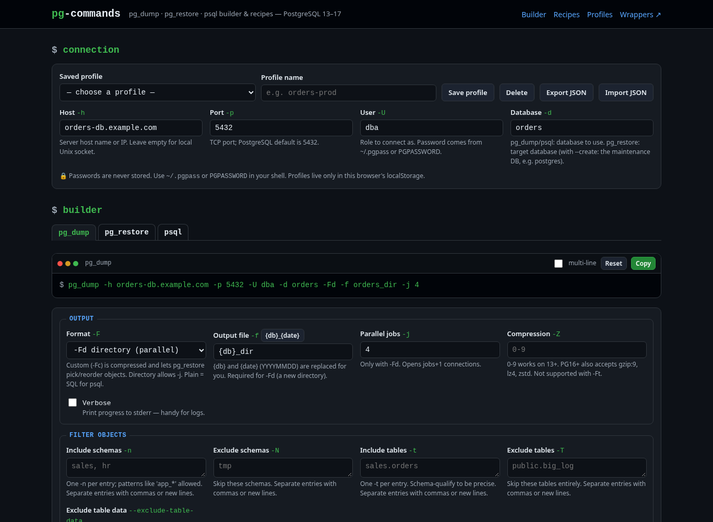
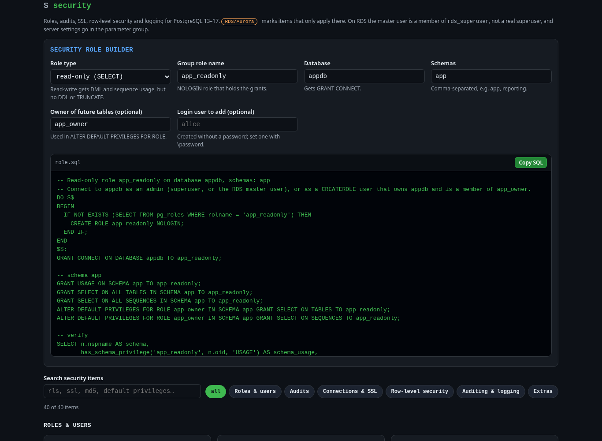
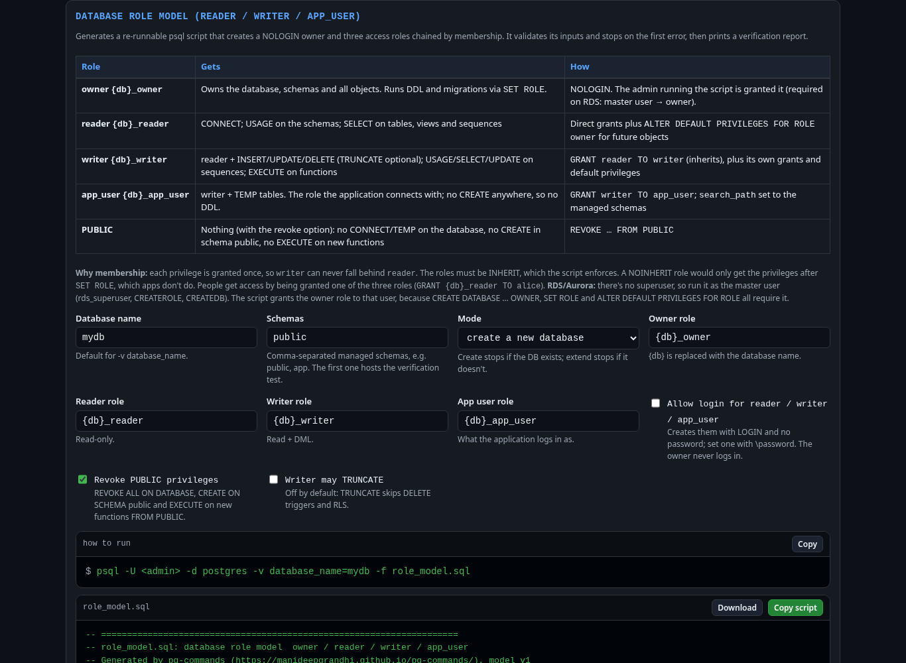
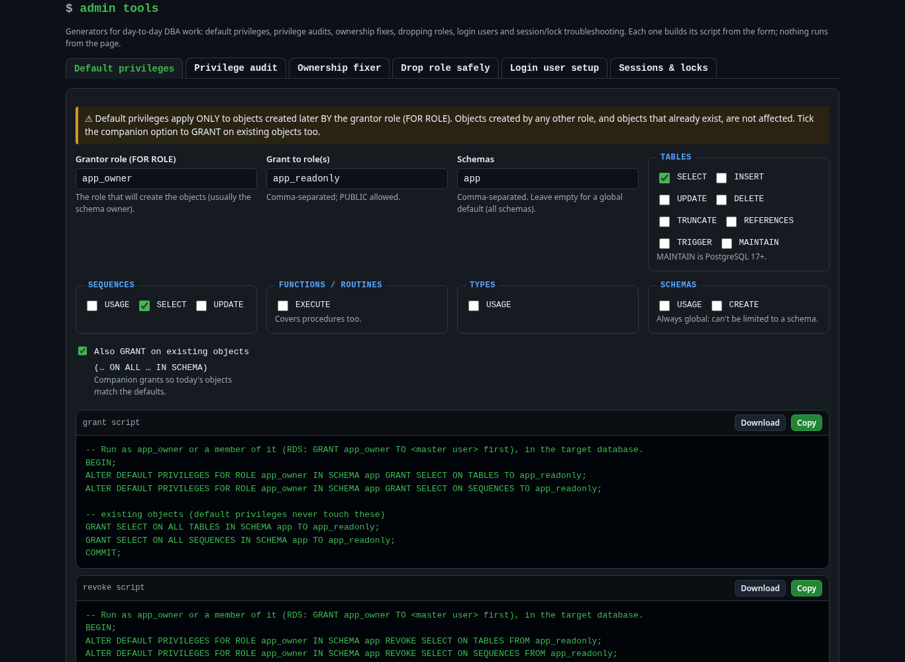
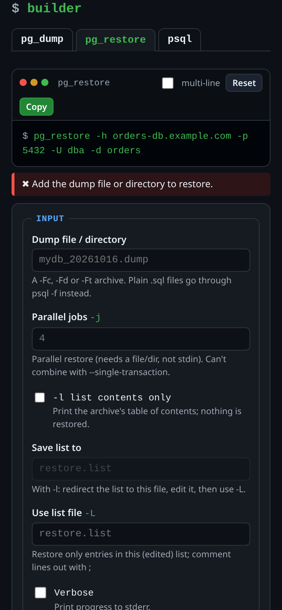
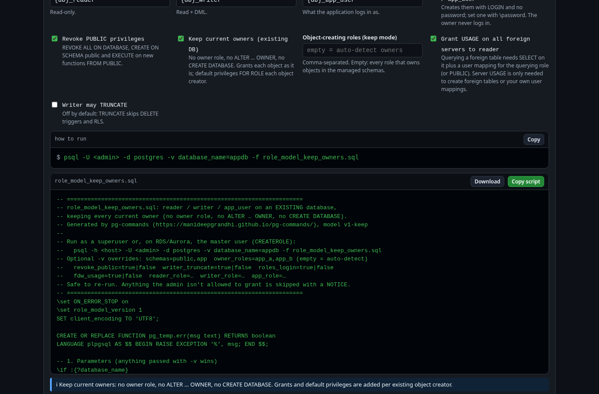
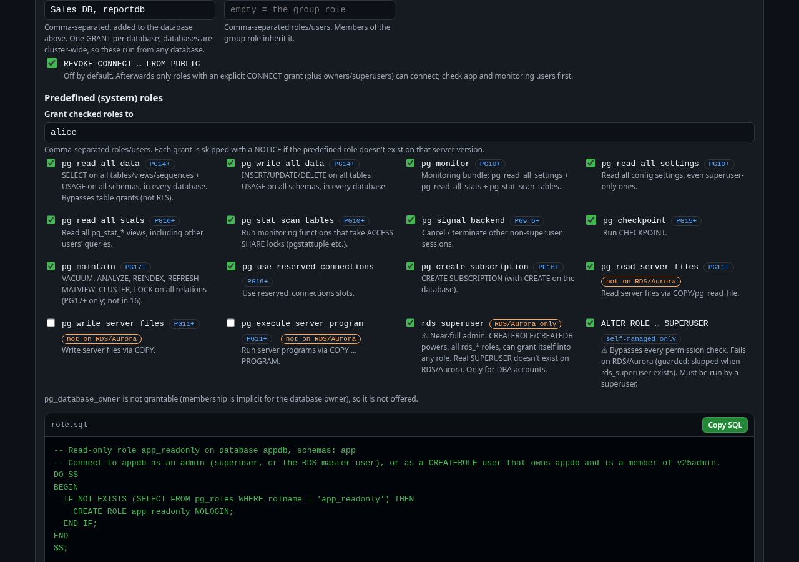

# pg-commands

**Live:** https://manideepgrandhi.github.io/pg-commands/

A daily-driver page for PostgreSQL client commands: **pg_dump**, **pg_restore** and **psql** (PostgreSQL 13–17).
It's one self-contained `index.html` with no build step, no CDNs and no server, so it works offline. Everything stays in your browser.

## Features
- **Command builder.** Tabs for pg_dump, pg_restore and psql, with grouped options and an explanation for each one. The command updates live with correct shell quoting, and has Copy, Reset and multi-line buttons.
- **Validation as you type.** It warns about `-j` without `-Fd`, `--single-transaction` with `-j`, `--clean` without `--if-exists`, `--if-exists` without `--clean`, compression with `-Ft`, a plain `.sql` file given to pg_restore, schema-qualified `pg_restore -t`, and scripts run without `ON_ERROR_STOP`. A **red banner** appears when the restore target host or database name contains `prod`.
- **`\copy` helper.** Turns a query into a client-side CSV export with `HEADER`.
- **27 recipes.** Each has the command, its purpose and a "watch out" note, with Copy and *Load into builder*. You can search them and filter by tool.
- **Security (v2).** 40 items in 6 categories: roles & users, audits, connections & SSL, row-level security, auditing & logging, and extras. Each has the SQL or command, its purpose, a "watch out" note and Copy, and you can search and filter them. RDS/Aurora differences are flagged: `rds_superuser`, `rds.force_ssl`, pgaudit via the parameter group, and pg_authid/pg_hba not being readable there.
- **Security role builder.** Generates a read-only or read-write role script (idempotent CREATE ROLE, grants, default privileges, an optional login user and a verification query) for any role, database and schemas.
- **Database role model generator (v2.1).** Builds a re-runnable psql script that creates a NOLOGIN owner (`{db}_owner`) and three access roles chained by membership: reader, then writer, then app_user.
  - reader gets CONNECT, USAGE and SELECT. writer adds DML (TRUNCATE optional), sequence use and EXECUTE. app_user adds TEMP and is the role the app logs in as. None of them can run DDL.
  - Default privileges cover new tables, sequences and functions that the owner creates later.
  - It has create and extend modes. Extend mode hands existing objects in the managed schemas to the owner.
  - Optional: revoke PUBLIC privileges, LOGIN for the three roles (no passwords), and TRUNCATE for writer.
  - Safety: inputs come from psql variables, a `pg_temp.err()` check stops the script on bad input, and `ON_ERROR_STOP` is on. Roles and grants are created idempotently with a NOTICE for each step.
  - It works on RDS/Aurora when run as the master user. The script grants the owner role to that user.
  - It ends with a verification report: memberships, privileges on a rolled-back test table, and default ACLs.
  - Run it with `psql -h <host> -U <admin> -d postgres -v database_name=mydb -f role_model.sql`. The page also has three standalone cards (reader, writer, app_user).
- **Admin tools (v2.2).** Six generators. Each builds its script from a form and has Copy and Download buttons; nothing runs from the page.
  1. **Default privileges:** pick the grantor (FOR ROLE), target roles, schemas, and privileges per object type. It gives you the grant script, a revoke script and a query of the existing default ACLs, plus optional companion `GRANT … ON ALL … IN SCHEMA` for objects that already exist.
  2. **Privilege audit:** what a role can access (tables, sequences, functions, schemas, databases; includes access through membership), who can access a table, the role membership tree up and down, default ACLs per schema, and objects owned by a role.
  3. **Ownership fixer:** a preview, then a re-runnable script that changes the owner of each object in the chosen schemas (tables, views, matviews, sequences, routines, types, and the schema itself). It skips extension members and column-owned sequences. A `REASSIGN OWNED` alternative is included, with its caveats.
  4. **Drop role safely:** a preview across databases, then a psql script that runs `REASSIGN OWNED` / `DROP OWNED` in each database, revokes memberships and runs `DROP ROLE IF EXISTS`. It works when run as the RDS master user.
  5. **Login user setup:** an idempotent login user with no password in the script (use `\password`). It sets VALID UNTIL, a connection limit, membership in a role-model role, and per-user statement/idle/lock timeouts and search_path.
  6. **Sessions & locks:** active sessions, long-running queries, idle-in-transaction sessions, the blocking tree from `pg_blocking_pids`, and lock details. It also generates `pg_cancel_backend` / `pg_terminate_backend` queries with safety filters.
- **Sample data (v2).** A `demo` schema (customers, products, categories, orders, order_items) with PKs, FKs, CHECKs, indexes and JSONB. It loads data three ways (hand-written INSERTs, generate_series with configurable row counts, and `\copy` from a downloadable CSV) and has 12 practice queries: joins, GROUP BY/HAVING, window functions, CTEs, a recursive CTE, JSONB with a GIN index, EXPLAIN ANALYZE, a transaction with ROLLBACK, and upsert. Use **Download demo.sql** or *Copy all*, then run `psql -d mydb -v ON_ERROR_STOP=1 -f demo.sql`. The cleanup step (`DROP SCHEMA demo CASCADE`) is included but commented out.
- **Connection profiles.** Saves name, host, port, user and database in localStorage, never passwords. You can export and import them as JSON.

Every builder combination, recipe, security item that can run locally, role builder script and the full demo script (10k rows) was run against a local PostgreSQL 17 server with the PG17 client tools.

## Also see
[pg-dump-wrapper](https://github.com/manideepgrandhi/pg-dump-wrapper): wrapper scripts for logged, scheduled pg_dump and psql runs.

## v2.3: Keep current owners (role model)

Turn on **Keep current owners** in the Database role model panel to add reader / writer / app_user to an *existing* database (e.g. Aurora PostgreSQL) without changing who owns anything:

- no owner role, no `ALTER … OWNER`, no `CREATE DATABASE`; missing schemas are reported, not created
- object-creating roles: listed by you, or auto-detected as the distinct owners of schemas, tables, views, matviews, foreign tables, sequences and routines in the managed schemas
- `ALTER DEFAULT PRIVILEGES FOR ROLE <owner>` for every creator, so future objects from any of them are covered
- grants are applied one object at a time; anything the admin can't grant is skipped with a NOTICE suggesting `GRANT <owner> TO <you>`
- foreign tables get table grants (querying also needs a user mapping); optional USAGE on all foreign servers for reader
- safe to re-run; the verification step shows owners (unchanged), effective privileges and default ACLs per owner

## v2.5: Database CONNECT and predefined roles (role builder)

v2.4 (EXECUTE/USAGE "Extra grants") was reverted; the role model is back to v2.3 behavior.

The Security role builder now has:

- **Database CONNECT**: extra comma-separated databases (plus the main one), a list of roles/users that get CONNECT (default: the group role), and an optional `REVOKE CONNECT … FROM PUBLIC` (off by default). Names are quoted when needed (`"Sales DB"`). Databases are cluster-level objects, so the GRANTs run once from any database.
- **Predefined roles** as checkboxes, each with its minimum version: `pg_read_all_data`, `pg_write_all_data` (14+), `pg_monitor`, `pg_read_all_settings`, `pg_read_all_stats`, `pg_stat_scan_tables` (10+), `pg_signal_backend`, `pg_checkpoint` (15+), `pg_maintain` (17+), `pg_use_reserved_connections`, `pg_create_subscription` (16+), and `pg_read_server_files` / `pg_write_server_files` / `pg_execute_server_program` (not on RDS/Aurora). `pg_database_owner` isn't grantable and is not offered.
- **rds_superuser** (RDS/Aurora, with a warning) and **ALTER ROLE … SUPERUSER** (self-managed only; skipped automatically when `rds_superuser` exists).
- Grants run in a DO block that checks `pg_roles`, so roles missing on older versions are skipped with a NOTICE. On PG16+ a CREATEROLE-only admin can't grant predefined roles without ADMIN OPTION; each such grant becomes a WARNING with a hint instead of aborting. On PG13–15 CREATEROLE is enough.
- Verify queries: `has_database_privilege(…, 'CONNECT')` per database/role and `pg_has_role` membership for each predefined role.

Tested on PostgreSQL 13, 16 and 17 as a CREATEROLE admin and as superuser.

